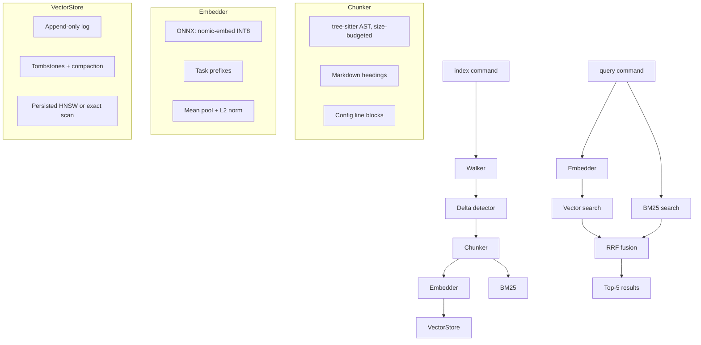

# codebase-indexer

Offline semantic code search. Walks a codebase, chunks source files with tree-sitter, embeds them with nomic-embed-text-v1.5 (INT8 ONNX), and indexes them for hybrid BM25 + vector search with RRF fusion.

## Architecture



## Usage

```bash
# Index a codebase
cargo run --release -- index <path>

# Search (hybrid BM25 + vector)
cargo run --release -- query "cosine similarity" <path>

# Use model files from another location
cargo run --release -- --models /path/to/models index <path>
CODEBASE_INDEXER_MODELS=/path/to/models cargo run --release -- query "auth" <path>

# Force full re-index
rm -rf <path>/.indexer && cargo run --release -- index <path>
```

`<path>` defaults to `.`. Results show the top-5 matches with file path, line range and code. Model files default to this repo's `models/` directory, so any codebase can be indexed without copying the model.

## Key Choices

| Decision | Choice | Why |
|----------|--------|-----|
| Embedding model | nomic-embed-text-v1.5 INT8, 768-dim | Strong retrieval quality, runs on CPU; inputs capped at 2048 tokens to bound memory |
| Runtime | ONNX via `ort` (MSVC) | Prebuilt Windows binaries |
| BM25 | Tantivy, lenient query parsing | Mature Rust full-text engine; code queries like `foo::bar()` never fail to parse |
| Vector index | Custom HNSW (diversity heuristic), persisted | Built once per index run; exact scan below 1K records or when the snapshot is stale |
| Fusion | RRF (k=60, 1-based ranks) | Combines keyword precision (BM25) with semantic recall (vector) |
| Chunking | tree-sitter AST with a size budget | Whole declarations when they fit; oversized ones split along child nodes and re-merged, with no duplicate or dropped code |
| Store format | Append-only log + tombstones | No rewrite on update; compacted when dead records outnumber live ones; truncated tails repaired on load |
| Delta detection | SHA-256 + mtime | Only new/modified files are re-embedded; deleted files are purged; failed files are retried |

## Index Layout

`<path>/.indexer/` holds `cache.bin` (file hashes), `vectors.bin` (record log), `vectors.hnsw` (graph snapshot, only for 1K+ records) and `bm25/` (Tantivy index).

## Setup

```bash
# Download the ONNX model (137MB), required before running
# Windows:
powershell -File models/download-model.ps1
# macOS/Linux:
bash models/download-model.sh

cargo build --release
```

Tokenizer files are committed; only the large ONNX binary needs downloading.

## Requirements

- **MSVC toolchain** on Windows: `.cargo/config.toml` sets `x86_64-pc-windows-msvc`. GNU/mingw is not supported (`ort` has no prebuilt binaries for it).
