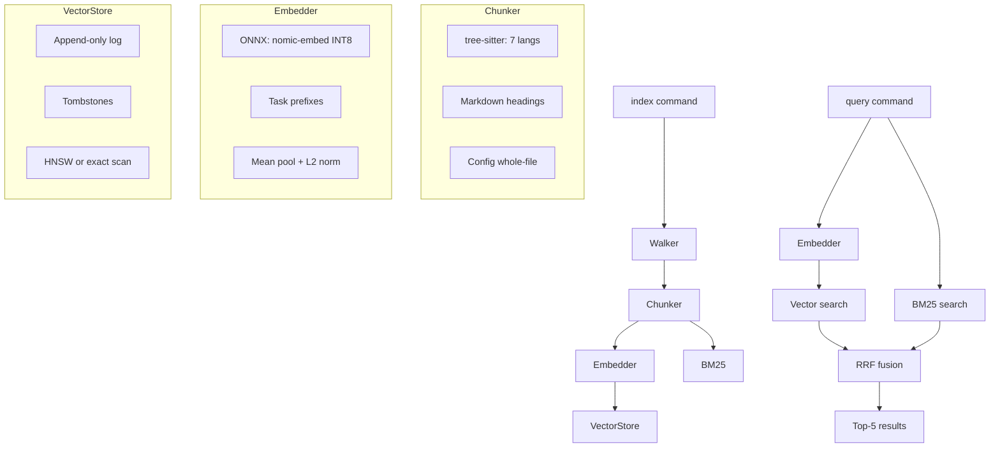

# codebase-indexer

Offline semantic code search. Walks a codebase, chunks source files with tree-sitter, embeds them with nomic-embed-text-v1.5 (INT8 ONNX), and indexes them for hybrid BM25 + vector search with RRF fusion.

## Architecture



## Usage

```bash
# Index a codebase
cargo run -- index <path>

# Search (hybrid BM25 + vector)
cargo run -- query "cosine similarity" <path>

# Force full re-index
rm -rf .indexer && cargo run -- index <path>
```

Default path is `.` (current directory). Results return top-5 matches with file path, line range, and code.

## Key Choices

| Decision | Choice | Why |
|----------|--------|-----|
| Embedding model | nomic-embed-text-v1.5 INT8 | 8K context (no truncation), code-aware, Matryoshka dims |
| Runtime | ONNX via `ort` (MSVC) | Prebuilt Windows binaries, custom op support |
| BM25 | Tantivy | Mature Rust full-text engine, STRING fields for exact deletion |
| Vector index | Custom HNSW | No external deps, switches to exact scan for <1K records |
| Fusion | RRF (k=60) | Combines keyword precision (BM25) + semantic recall (vector) |
| Chunking | tree-sitter AST | Structure-aware, handles 7 languages + markdown/config |
| Store format | Append-only log + tombstones | No rewrite on update, SHA-256 + mtime delta detection |

## Setup

```bash
# Download the ONNX model (137MB) — required before building
# Windows:
powershell -File models/download-model.ps1
# macOS/Linux:
bash models/download-model.sh

cargo build
```

Tokenizer files are committed; only the large ONNX binary needs downloading.

## Requirements

- **MSVC toolchain** — `.cargo/config.toml` sets `x86_64-pc-windows-msvc`. GNU/mingw not supported (`ort` has no prebuilt binaries for it).